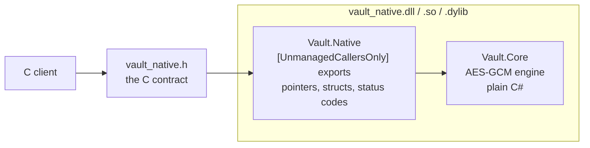
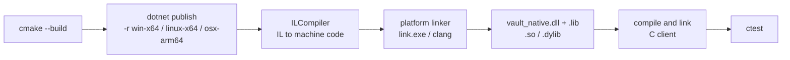
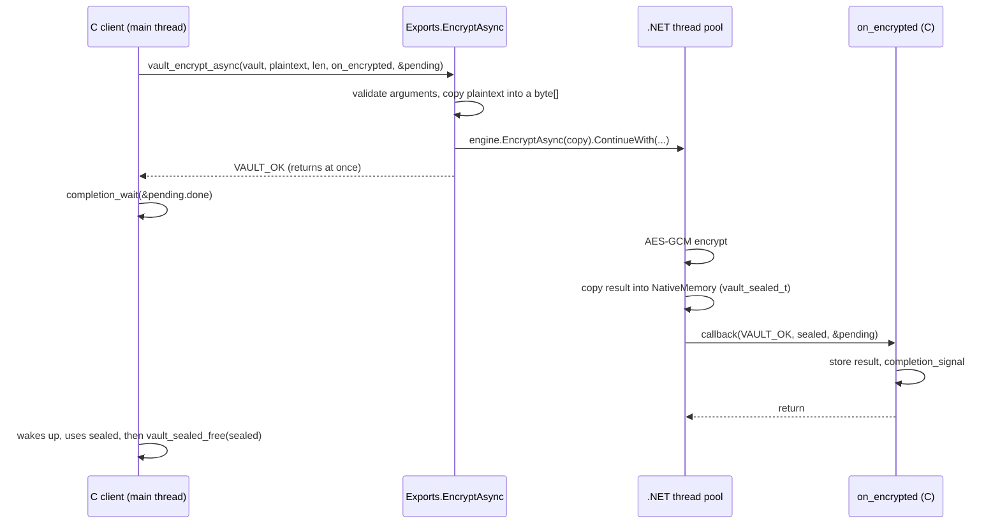

# How it works

This page follows the code from C# source to a C program calling it: what NativeAOT
produces, how the build is wired, and what happens during a single call.

## Three layers

- **Vault.Core** is ordinary C#. It takes `ReadOnlySpan<byte>`, returns records and
  `Task`s, and throws exceptions. It has no idea it will be called from C.
- **Vault.Native** is the only place that knows about the boundary. It translates
  pointers into spans, status codes from exceptions, and `Task`s into callbacks.
- **vault_native.h** is the contract. The C side relies on nothing else, so any
  language that can call C (Rust, Python, Go, ...) can use the library.

Keeping the interop code in its own thin layer means the core stays testable and
reusable, and every unsafe operation is in one file:
[`Exports.cs`](../src/Vault.Native/Exports.cs).

## What NativeAOT produces

A normal .NET build produces IL that the runtime compiles just in time. With
`<PublishAot>true</PublishAot>` and `<NativeLib>Shared</NativeLib>`, `dotnet publish`
instead compiles everything ahead of time into machine code and links it into an
ordinary shared library:

- The library contains its own copy of the runtime pieces it needs: the garbage
  collector, the type system and the thread pool. The machine running the client
  needs no .NET installation.
- The runtime starts on the first call into any export. There is no init function
  to call first.
- Every method marked `[UnmanagedCallersOnly(EntryPoint = "vault_open")]` becomes a
  real exported symbol named `vault_open`, callable with the platform's C calling
  convention.
- Unused code is trimmed away. The whole library, crypto included, is about 1.2 MB on
  Windows.

Things that don't work under NativeAOT, such as loading assemblies at run time or
unrestricted reflection, are flagged at build time by `<IsAotCompatible>`. This
project uses none of them.

## The build

One CMake build drives both toolchains:

[`CMakeLists.txt`](../CMakeLists.txt) maps the platform to a .NET runtime identifier,
runs `dotnet publish` as a custom command, and wraps the result in an `IMPORTED`
library target. The C client links against that target like any other library.
Changing a `.cs` file triggers a new publish on the next build.

## One call, step by step

Here is `vault_encrypt_async`, the most involved export, from the C side down:

What each step guards against:

1. **Argument checks come first.** A null pointer or a length over `int.MaxValue`
   returns `VAULT_ERR_INVALID_ARGUMENT` instead of crashing.
2. **The input is copied before returning.** The caller may free or reuse its buffer
   as soon as the call returns, even though the work hasn't started yet.
3. **The function returns before the work is done.** The calling thread is never
   blocked.
4. **The callback runs on a thread-pool thread.** The C side must not assume which
   thread it is on. The client hands the result to the main thread through
   `user_data` and a condition variable, with no globals and no `sleep()`.
5. **The callback fires exactly once.** If encryption throws, the continuation still
   calls back, with `VAULT_ERR_INTERNAL` and a null result, so the caller never
   waits forever.
6. **The result belongs to the library's allocator.** The caller returns it with
   `vault_sealed_free`, never `free()`.

## Errors at the boundary

An exception that escapes an `[UnmanagedCallersOnly]` method terminates the process.
C has no way to catch it. So every export wraps its body in `try`/`catch` and maps
what it catches to a status code:

| Managed exception | C status |
|---|---|
| `AuthenticationTagMismatchException` | `VAULT_ERR_AUTHENTICATION_FAILED` |
| `ArgumentException` (wrong nonce or tag size) | `VAULT_ERR_INVALID_ARGUMENT` |
| anything else | `VAULT_ERR_INTERNAL` |

`vault_status_message` turns any code into readable text, for logs.

What can't be caught is memory corruption: a dangling or garbage pointer from C is
undefined behaviour, as with any C library. The header documents every pointer's
rules so callers can avoid it.
